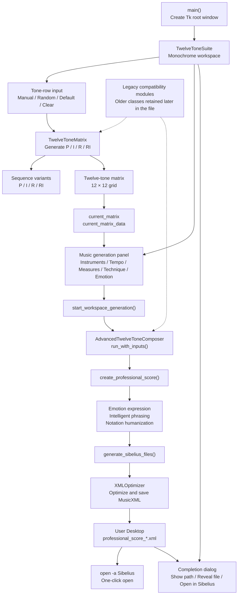
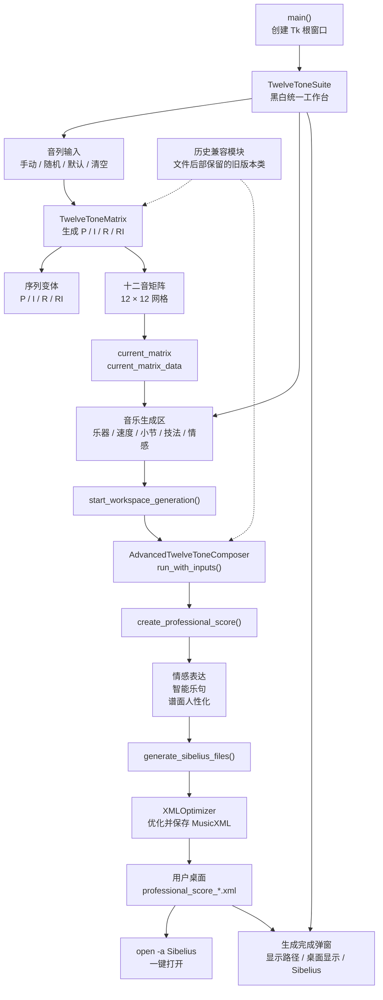

# Twelve-Tone Suite Architecture / 十二音工具代码架构

## English

The Mermaid diagram below shows the main runtime path. GitHub renders it as a diagram.

### Main modules

| Module | Responsibility |
| --- | --- |
| `TwelveToneSuite` | Main window, input controls, matrix display, and music-generation entry point |
| `TwelveToneMatrix` | Twelve-tone row and P/I/R/RI transformations |
| `AdvancedTwelveToneComposer` | Creates a score from the matrix and composition settings |
| `EmotionExpressionSystem` | Dynamics and expressive shaping |
| `PhrasingIntelligence` | Phrase-level development and shaping |
| `HandwrittenNotationGenerator` | Humanizes notation details |
| `XMLOptimizer` | Optimizes and writes MusicXML |
| `open_in_sibelius()` | Passes the generated file to Sibelius through the operating system |

### Runtime flow

1. The user enters or randomizes a row in `TwelveToneSuite`.
2. `TwelveToneMatrix` calculates the transformations and matrix.
3. The music-generation panel reads the current matrix and composition settings.
4. `AdvancedTwelveToneComposer` creates a `music21` score.
5. `XMLOptimizer` saves the result to the Desktop.
6. The result dialog can open the XML file in Sibelius.

---

## 中文

下方 Mermaid 图展示桌面程序的主要运行链路，GitHub 会自动将其渲染成架构图。

### 主要模块

| 模块 | 作用 |
| --- | --- |
| `TwelveToneSuite` | 主窗口、输入控件、矩阵展示和音乐生成入口 |
| `TwelveToneMatrix` | 十二音序列与 P/I/R/RI 变换 |
| `AdvancedTwelveToneComposer` | 根据矩阵和作曲参数生成乐谱对象 |
| `EmotionExpressionSystem` | 力度与情感表达处理 |
| `PhrasingIntelligence` | 乐句级的发展与处理 |
| `HandwrittenNotationGenerator` | 谱面细节人性化处理 |
| `XMLOptimizer` | 优化并输出 MusicXML |
| `open_in_sibelius()` | 调用系统命令交给 Sibelius 打开 |

### 运行时数据流

1. 用户在 `TwelveToneSuite` 中输入或随机生成音列。
2. `TwelveToneMatrix` 计算序列变换和矩阵。
3. 音乐生成区读取当前矩阵和作曲参数。
4. `AdvancedTwelveToneComposer` 创建 `music21` 乐谱对象。
5. `XMLOptimizer` 将结果保存到桌面。
6. 用户可从结果窗口调用 Sibelius 打开 XML 文件。
