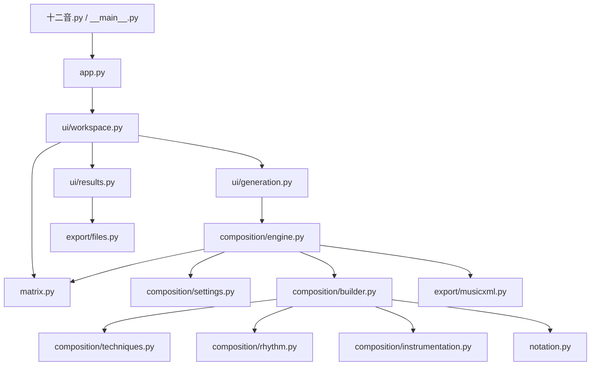

# Architecture / 代码架构

本文描述仓库实际存在的文件及其调用关系。入口、界面、算法、作曲服务、乐谱处理和导出均有对应源文件。

This document describes implemented source modules and their dependencies.

## 模块与依赖 / Modules

| 文件 | 职责 | 依赖边界 |
| --- | --- | --- |
| `十二音.py`, `twelve_tone/__main__.py` | 兼容脚本与包启动入口 | 仅调用 `app.main()` |
| `app.py` | 创建一次 Tk 根窗口并启动工作台 | 延迟加载 Tk 和 UI |
| `ui/workspace.py` | 输入控件、矩阵渲染、音乐参数、生成状态 | 调用矩阵算法和生成任务 |
| `ui/generation.py` | 后台线程生成；用队列传递结果 | 不访问 Tk 控件 |
| `ui/results.py` | 结果弹窗、文件操作反馈 | 调用平台文件服务 |
| `matrix.py` | 音列解析校验、12 × 12 矩阵、48 种变体 | 纯 Python，不依赖 GUI 或 music21 |
| `composition/settings.py` | 音域、速度、作曲策略配置 | 每个引擎实例有独立配置 |
| `composition/techniques.py` | 选择和变换序列 | 读取配置；不依赖 UI |
| `composition/rhythm.py` | 节奏、织体、力度计划 | 读取配置；不依赖 UI |
| `composition/instrumentation.py` | 音域、和弦、演奏法、装饰音 | 操作 music21 音高与记谱对象 |
| `composition/builder.py` | 构建声部、小节、总谱 | 组合技法、节奏、乐器法及表情处理 |
| `composition/engine.py` | 接收参数，组织矩阵、构谱、导出 | 不依赖 Tk；可由脚本直接调用 |
| `notation.py` | 情感演奏法、呼吸记号、乐句连线 | 操作 music21 总谱 |
| `export/musicxml.py` | 补充导出所需元数据，写入 MusicXML | 不依赖 UI |
| `export/files.py` | 打开乐谱、定位文件 | 仅标准库系统调用 |
| `dependencies.py` | 检测可选的 music21；提供缺失错误 | 矩阵和界面启动不强制安装 music21 |
| `i18n.py` | 中英文作曲日志文本 | 当前不提供整套 UI 文案切换 |

## 调用方向 / Dependency direction



图中的箭头表示调用或组合依赖。`engine.py` 创建服务对象并传给 `ScoreBuilder`，没有运行时替换类方法或热补丁。所有底层模块都不反向导入 UI。

Arrows indicate calls or composed dependencies. The engine constructs services and passes them to the score builder. Lower-level modules do not import UI modules. There is no monkey-patching or alternate startup chain.

## 数据流 / Data flow

1. 工作台调用 `parse_tone_row()`，得到包含 0–11 的十二音音级列表。
2. `build_matrix()` 返回用于显示的二维列表；`build_variants()` 返回按 `P/I/R/RI` 分组的 48 种序列。
3. 工作台读取乐器、速度、小节数、技法、情感，将参数交给 `GenerationTask`。
4. 后台线程创建 `AdvancedTwelveToneComposer`。引擎校验导入序列并将其转换为 `P0` … `RI11` 字典。
5. `ScoreBuilder` 调用技法、节奏和乐器法服务创建 `music21.stream.Score`，再处理表情与乐句。
6. `MusicXMLExporter` 通过 `XMLOptimizer` 写入文件，返回路径。
7. 后台线程将成功路径或错误文本放入队列。Tk 主线程通过 `after()` 轮询队列并更新界面。
8. 用户可在结果窗口打开或定位文件；导出流程本身不自动启动外部应用。

The worker communicates exclusively through a queue. Tk calls remain on the main thread. Headless callers can invoke the same composition engine without opening a window.

## 矩阵约定 / Matrix convention

输入音列记为 `p`，显示矩阵为：

```text
M[i][j] = (p[j] + p[0] - p[i]) mod 12
```

因此首行保持输入音列，所有行和列都是 0–11 的排列。主对角线恒为输入的首音；十二音矩阵不要求对角线包含十二个不同音级。

为保留既有作曲序列的含义，变体编号使用相对半音移位：

```text
P0  = p
I0  = (-p) mod 12
R0  = reverse(p)
RI0 = reverse(I0)
Xn  = (X0 + n) mod 12
```

显示矩阵的行标记为 `P((p[0] - p[i]) mod 12)`，列标记为 `I((p[0] + p[j]) mod 12)`，与上述变体编号对应。这不是把输入首音统一归一化为 C 的编号方式。

The display matrix preserves the supplied first row. Variant suffixes denote semitone transpositions of the supplied base forms; I0 is inversion about pitch class zero. The diagonal need not contain twelve distinct pitches.

## 运行边界 / Runtime limits

- Tk 只负责交互；`matrix.py` 不加载 Tk 或 music21。
- 没有 music21 仍可使用矩阵；开始构谱时给出安装提示。
- “情感”应用预设演奏法密度和乐句呼吸处理；不是情绪识别模型。
- 作曲策略来自原实现；名称不是音乐学准确性或完整风格模拟的承诺。
- 原“手写谱面”方法只有占位逻辑，已移除，未作为有效能力展示。
- 旧工作台、AI 开发提示词、嵌套补丁代码保留在 Git 历史中；不参与当前启动。

旧代码处理与兼容方式见 [迁移说明](docs/MIGRATION.md)。
