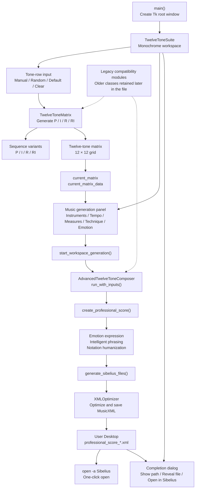

# Twelve-Tone Matrix / 十二音矩阵

## English

A desktop tool for twelve-tone composition. Its monochrome workspace combines tone-row input, P/I/R/RI transformations, the 12 × 12 matrix, composition settings, and MusicXML export in one screen.

### Features

- Enter or randomly generate a twelve-tone row
- View Prime (P), Inversion (I), Retrograde (R), and Retrograde Inversion (RI)
- Display the complete 12 × 12 twelve-tone matrix
- Generate a MusicXML score from the current matrix
- Save generated XML files to the Desktop
- Open the latest MusicXML file in Sibelius with one click on macOS

### Run

Python 3.10 or later is recommended.

```bash
pip install music21
python3 十二音.py
```

The matrix interface can open without `music21`; the library is required for MusicXML score generation.

### Files

- `十二音.py` — desktop application, matrix tools, score generation, and Sibelius export
- `ARCHITECTURE.md` — bilingual architecture diagram and call flow

### Output

MusicXML files are saved to the current user's Desktop with names similar to:

```text
professional_score_2026-10-22T12-30-00.xml
```

After generation, choose **Open in Sibelius** in the result dialog.

### Note

Some legacy algorithm modules remain in `十二音.py` for compatibility. The application starts from the `TwelveToneSuite` GUI entry point near the beginning of the file.

---

## 中文

一个面向十二音作曲流程的桌面工具。黑白工作台把音列输入、P/I/R/RI 变换、十二音矩阵、作曲参数和 MusicXML 导出放在同一个界面中。

### 功能

- 输入或随机生成十二音序列
- 查看原形（P）、倒影（I）、逆行（R）和逆行倒影（RI）
- 展示完整的 12 × 12 十二音矩阵
- 根据当前矩阵生成 MusicXML 乐谱
- 自动将生成的 XML 文件保存到桌面
- macOS 上支持一键调用 Sibelius 打开最近生成的 MusicXML

### 运行

建议使用 Python 3.10 或更新版本。

```bash
pip install music21
python3 十二音.py
```

不安装 `music21` 也可以打开矩阵界面；生成 MusicXML 乐谱时需要该库。

### 文件

- `十二音.py`：桌面程序、十二音矩阵、乐谱生成和 Sibelius 导出
- `ARCHITECTURE.md`：双语代码架构图和调用流程

### 输出

MusicXML 默认保存在当前用户的桌面，文件名类似：

```text
professional_score_2026-10-22T12-30-00.xml
```

生成完成后，可在结果窗口点击“在 Sibelius 中打开”。

### 说明

`十二音.py` 中保留了部分历史算法模块以兼容已有功能。程序从文件前部的 `TwelveToneSuite` 图形界面入口启动。


## Architecture at a glance / 代码架构

The diagram follows the public application entry point and export path. The author chooses musical material and the compositional settings.



[Read the detailed bilingual architecture](ARCHITECTURE.md).
