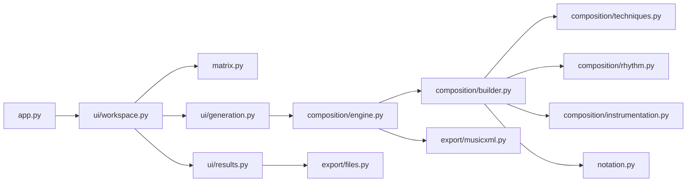

# Twelve-Tone Suite / 十二音矩阵

一个 Tk 桌面作曲工具：输入十二音音列，查看 P / I / R / RI 变体与 12 × 12 矩阵，再根据乐器、速度、小节数、技法和情感设置生成 MusicXML。

A Tk desktop tool for twelve-tone rows, transformations, matrix inspection and algorithmic MusicXML composition.

## 运行 / Run

需要 Python 3.10+。桌面界面需要当前 Python 带有 `tkinter`；导出乐谱需要 `music21`。

```bash
python -m pip install -r requirements.txt
python -m twelve_tone
```

原有启动方式继续可用：

```bash
python 十二音.py
```

也可安装为命令：

```bash
python -m pip install '.[score]'
twelve-tone
```

For the desktop app, use a Python distribution with Tk support. `music21` is optional for matrix use and required for score generation. On Linux, Tk may need the distribution's `python3-tk` package. If using Homebrew Python on macOS, install the matching `python-tk` package or use a Python distribution that includes Tk.

## 真实工程结构 / Source layout

```text
twelve-tone-suite/
├── 十二音.py                     # 兼容启动入口（6 行）
├── pyproject.toml                # 包配置、可选依赖、命令入口
├── requirements.txt
├── twelve_tone/
│   ├── app.py                    # 唯一的 Tk 启动流程
│   ├── __main__.py               # python -m twelve_tone
│   ├── matrix.py                 # 纯算法：输入校验、矩阵、48 种变体
│   ├── dependencies.py           # 可选 music21 依赖检查
│   ├── i18n.py                   # 中英文生成日志
│   ├── notation.py               # 表情处理、乐句连线
│   ├── composition/
│   │   ├── settings.py           # 乐器音域、速度和技法配置
│   │   ├── techniques.py         # 序列选择与发展策略
│   │   ├── rhythm.py             # 节奏、钢琴织体、力度计划
│   │   ├── instrumentation.py    # 音区、和弦、演奏法与装饰音
│   │   ├── builder.py            # 声部、小节和总谱构建
│   │   └── engine.py             # 作曲流程协调与控制台输入
│   ├── export/
│   │   ├── musicxml.py           # MusicXML 序列化与输出路径
│   │   └── files.py              # 系统文件打开与定位
│   └── ui/
│       ├── workspace.py          # 统一工作台和矩阵显示
│       ├── generation.py         # 后台生成任务与结果队列
│       └── results.py            # 完成弹窗与文件操作反馈
├── tests/                        # 算法、生成、导出、入口与 Tk 测试
├── docs/MIGRATION.md             # 旧代码清理和行为变更说明
└── .github/workflows/tests.yml   # Python 3.10 / 3.12 / 3.14 检查
```

这些目录都包含实际实现。`engine.py` 组合独立的技法、节奏、乐器法和乐谱构建对象；界面通过后台任务调用引擎。矩阵算法不依赖 Tk 或 `music21`。

These are implementation modules. The composition engine coordinates separate strategy, rhythm, instrumentation and score-builder services. The matrix module has no GUI or score-library dependency.



详细的模块依赖、数据流与边界见 [ARCHITECTURE.md](ARCHITECTURE.md)。

## 能力与边界 / Scope

- 输入数字或音名，支持常用升降音名；生成全部 48 种 P / I / R / RI 移位变体。
- 完整矩阵保留输入首行，每行、每列均包含 12 个不同音级。
- 保留六种既有作曲策略，以及钢琴双声部、情感演奏法和乐句连线处理。
- MusicXML 默认保存至桌面；桌面目录无法创建时退回当前目录。文件名带微秒时间戳。
- macOS 上可调用 Sibelius 打开；Windows / Linux 使用系统默认 MusicXML 应用。
- 没有接入 LLM 服务；技法名称代表既有算法策略，不意味着完整模拟某位作曲家或实现所有现代作曲技术。
- 不包含原先仅有 `pass` 的手写谱面/人性化占位模块。MusicXML 导出并不等同于 Sibelius 原生 `.sib` 文件。

The app generates MusicXML, not native Sibelius projects. Composer-style presets use local algorithms; no LLM service is connected. Windows and Linux use the system's default MusicXML application. Unimplemented handwriting/humanization placeholders are excluded.

## 无窗口调用 / Headless use

矩阵计算无需额外依赖：

```python
from twelve_tone.matrix import parse_tone_row, build_matrix, build_variants

row = parse_tone_row('C Db D Eb E F Gb G Ab A Bb B')
matrix = build_matrix(row)
variants = build_variants(row)
```

安装 `music21` 后可直接生成乐谱，自行指定输出目录：

```python
from twelve_tone.composition.engine import AdvancedTwelveToneComposer

composer = AdvancedTwelveToneComposer(output_dir='scores')
variants = composer.generate_matrix('C C# D D# E F F# G G# A A# B')
score = composer.create_professional_score(
    ['Flute', 'Piano'], variants, 'Andante', 85,
    num_measures=8, technique='webern', emotion='lyrical',
)
filename = composer.generate_sibelius_files(score)
print(filename)
```

## 验证 / Tests

```bash
python -m unittest discover -s tests -v
```

未安装 `music21` 时跳过乐谱集成测试，仍运行算法、入口、队列和系统调用测试。安装后会运行六种技法的总谱生成和 MusicXML 回读检查。

在有 Tk 图形环境的桌面上，可额外运行真实窗口控件和后台生成测试：

```bash
RUN_GUI_TESTS=1 python -m unittest discover -s tests -v
```

Without `music21`, score integration tests are skipped. The opt-in desktop test also requires a graphical Tk environment. CI covers the package with and without score dependencies; it does not launch Sibelius.
